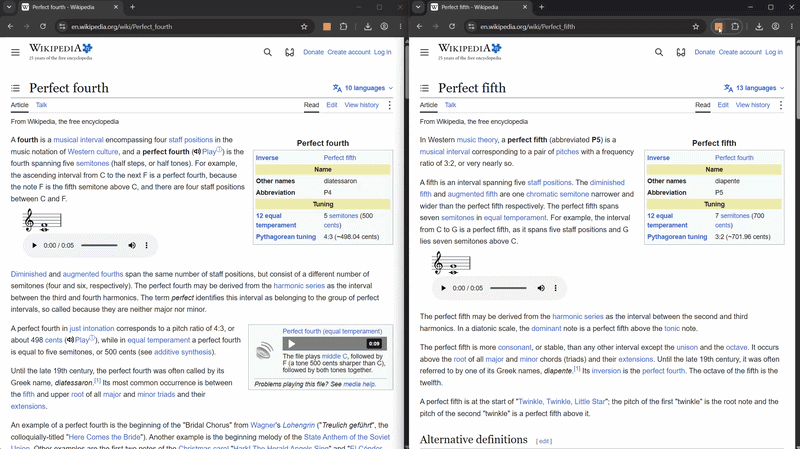
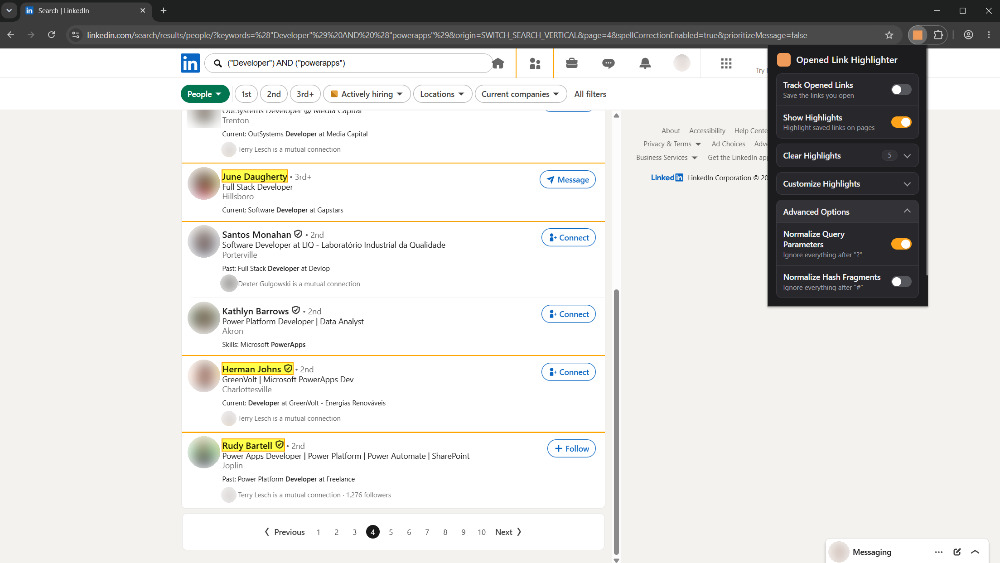
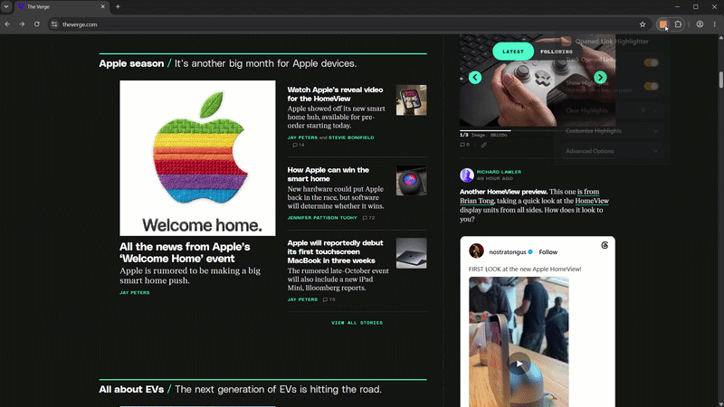
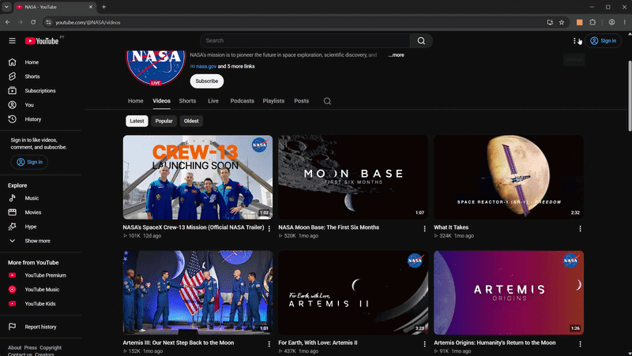
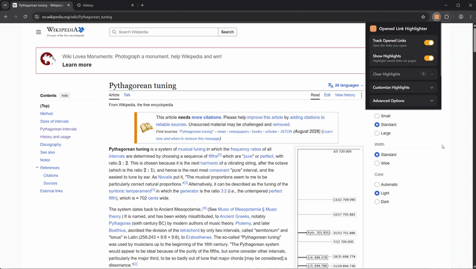
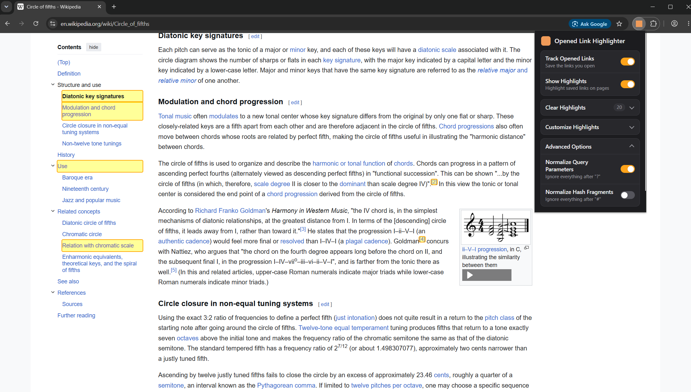
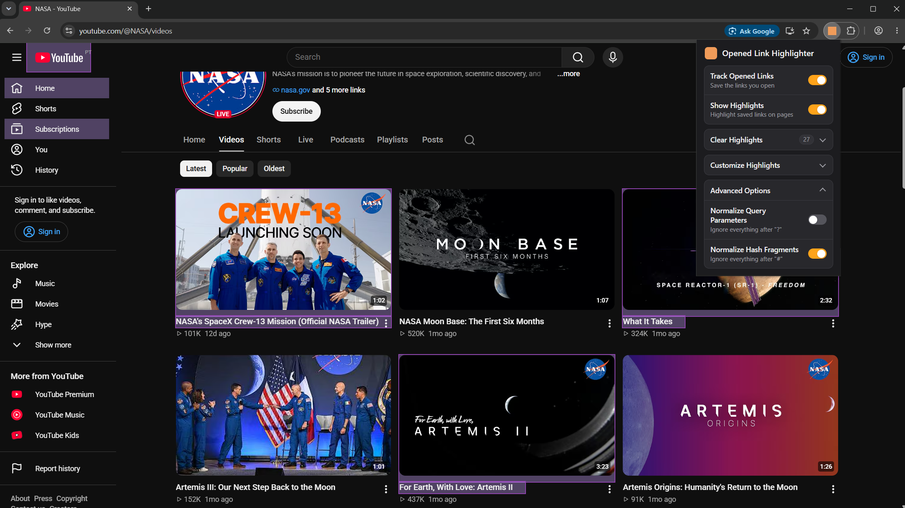
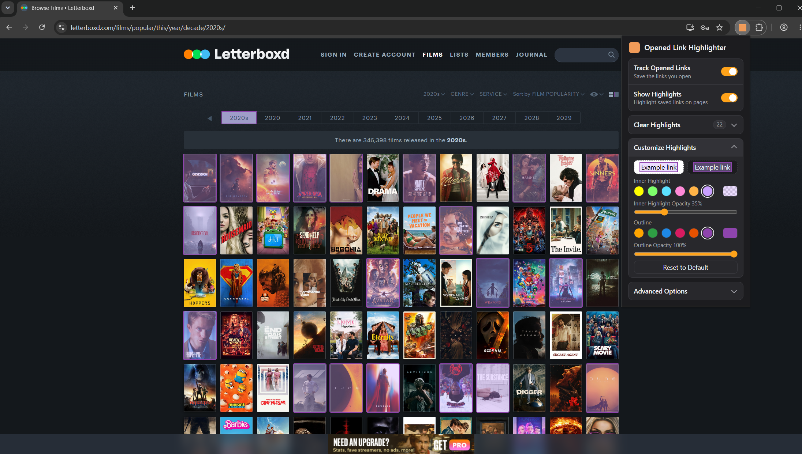

# Opened Link Highlighter

A simple browser extension that highlights all links opened on any tab while tracking was toggled on. Highlights can be hidden and shown again without losing them, cleared at any time, and customized with your own colors and opacity. Geared towards recruiters, researchers, or anyone wanting to keep track of which links they've opened.

#### Available on [Firefox](https://addons.mozilla.org/en-US/firefox/addon/opened-link-highlighter/) and [Chrome](https://chromewebstore.google.com/detail/opened-link-highlighter/hbdaiciogdfmibiekklhllpbldhodbil?authuser=0&hl=en-GB).

_Open a link on one page, and it's highlighted on every other page and tab where it appears, without refreshing. It also works on endless scrolling pages, where links are highlighted as they appear._

_On LinkedIn, the profiles you've already opened stand out in every search. (The names and photos in this image were anonymized.)_

## Use cases

- A recruiter browsing candidate profiles on LinkedIn can instantly see which profiles they’ve already reviewed.

- A researcher can stay oriented in long-form content, seeing at a glance which pages, or even which sections, they’ve already explored.

- Any situation where someone might want to keep track of which links they've visited (e.g. links on Google Search, movies on Letterboxd, books on Goodreads etc.)

## How to use

Click the extension's icon to open its popup, turn on "**Track Opened Links**", and browse as usual: every link you open from then on is highlighted wherever it appears.

The popup has the following options:

- **Track Opened Links**  
  While toggled on, every link you open is saved → saved links are the ones that get highlighted.
  - **Note**: toggling it off doesn't remove your saved links, it only stops new ones from being saved.

- **Show Highlights**  
  While toggled on, saved links are highlighted on every tab. Toggle it off to temporarily hide the highlights, without losing your saved links.

- **Clear Highlights**  
  Removes all saved links. Asks "**Are you sure?**" before clearing them.

### Customize Highlights

By default, links are highlighted in yellow with an orange outline. This is customizable under "**Customize Highlights**" on the popup:

- **Inner Highlight**  
  The color that fills the link, and its opacity.

- **Outline**  
  The color of the border around the link, and its opacity.

"**Reset to Default**" brings back the original colors.

_On a dark page with white links, the default yellow can make the text hard to read: pick another color and lower the opacity, and every page updates as you choose._

### Normalization

By default, this extension normalizes all URLs by removing all query parameters and hash fragments. **This leads to ideal results on LinkedIn**.

However, normalizing URLs may lead to results that aren't ideal on other websites. For this reason, URL normalization is customizable under "**Advanced Options**" on the popup:

- **Normalize Query Parameters**  
  Strips everything after `?` → treats URLs that differ by query parameters as the same.
  - **Example**: ``https://www.youtube.com/watch?v=VIDEO_ID`` → becomes ``https://www.youtube.com/watch``.
  - **Use case**: YouTube uses ``?`` to tell videos apart, so with normalization on, opening one video highlights every video. If you want to track which videos you've opened, turn off query parameter normalization.

  

  _With normalization on, every video is highlighted; with it off, only the videos you opened._

- **Normalize Hash Fragments**  
  Strips everything after `#` → treats section-anchor links as one page.
  - **Example**: ``https://en.wikipedia.org/wiki/JavaScript#Syntax`` → becomes ``https://en.wikipedia.org/wiki/JavaScript``.
  - **Use case**: Wikipedia uses ``#`` to jump to specific sections, so if you want to track which sections you’ve visited, turn off hash fragment normalization so each section link remains distinct.

  

  _On Wikipedia the table of contents links differ only by their hash fragments: with normalization off, each section you opened is highlighted on its own._

**Note**: the full URL is always saved, so these settings can be toggled on or off at any time without losing which specific links you've opened.

---

## Additional Images

