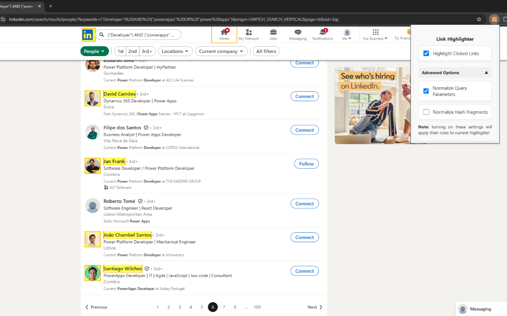
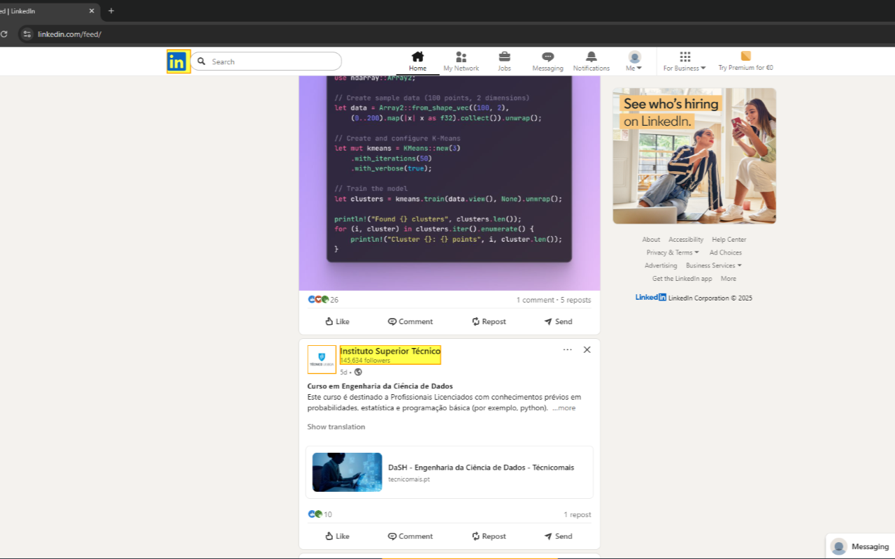
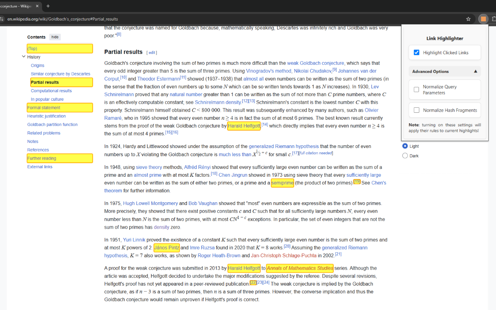
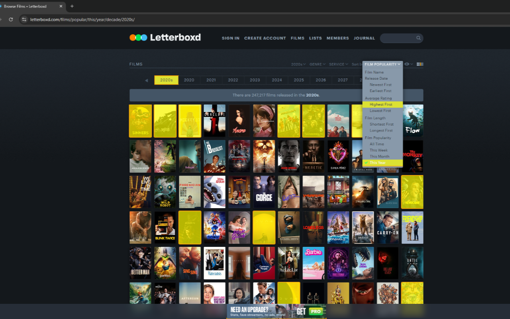

# Link Highlighter

A simple browser extension that highlights all links opened on any tab while tracking was toggled on. Highlights can be hidden and shown again without losing them, cleared at any time, and customized with your own colors and opacity. Geared towards recruiters, researchers, or anyone wanting to keep track of which links they've opened.

#### Available on [Firefox](https://addons.mozilla.org/en-US/firefox/addon/url-highlighter/) and [Chrome](https://chromewebstore.google.com/detail/link-highlighter/hbdaiciogdfmibiekklhllpbldhodbil).

---

### Use cases

- A recruiter browsing candidate profiles on LinkedIn can instantly see which profiles they’ve already reviewed.

- A researcher can stay oriented in long-form content, seeing at a glance which pages, or even which sections, they’ve already explored.

- Or any situation where someone might want to keep track of which links they've visited (e.g. movies on Letterboxd, links on Google Search, etc.)

### How to use

All options are found on the extension's popup:

- **Track Opened Links**  
  While toggled on, every link you open is saved → saved links are the ones that get highlighted.
  - **Note**: toggling it off doesn't remove your saved links, it only stops new ones from being saved.

- **Show Highlights**  
  While toggled on, saved links are highlighted on every tab.
  - **Use case**: toggle it off to temporarily hide the highlights, without losing your saved links.

- **Clear Highlights**  
  Removes all saved links. Shows how many links are currently saved, and asks "**Are you sure?**" before clearing them.

### Customize Highlights

By default, links are highlighted in yellow with an orange outline. This is customizable under "**Customize Highlights**" on the popup:

- **Inner Highlight**  
  The color that fills the link, and its opacity.

- **Outline**  
  The color of the border around the link, and its opacity.
  - **Example**: setting the outline opacity to 0% removes the outline entirely.

"**Reset to Default**" brings back the original colors.

_I'm personally a big fan of the purple highlighting._

### Advanced Options

By default, this extension normalizes all URLs by removing all query parameters and hash fragments. **This leads to ideal results on LinkedIn**.

However, normalizing URLs may lead to results that aren't ideal on other websites. For this reason, URL normalization is customizable under "**Advanced Options**" on the popup:

- **Normalize Query Parameters**  
  Strips everything after `?` → treats URLs that differ by query parameters as the same.
  - **Example**: ``https://github.com/TiDeane?tab=repositories`` → becomes ``https://github.com/TiDeane``.
  - **Use case**: Github uses ``?`` to divide tabs on a user's profile, so if you want to track which tabs you've visited, turn off query parameter normalization.

- **Normalize Hash Fragments**  
  Strips everything after `#` → treats section-anchor links as one page.
  - **Example**: ``https://en.wikipedia.org/wiki/JavaScript#Syntax`` → becomes ``https://en.wikipedia.org/wiki/JavaScript``.
  - **Use case**: Wikipedia uses ``#`` to jump to specific sections, so if you want to track which sections you’ve visited, turn off hash fragment normalization so each section link remains distinct.

**Note**: the full URL is always saved, so these settings can be toggled on or off at any time without losing which specific links you've opened.

## Example Images

<!-- TODO: UPDATE WITH NEW VERSION -->

